# 飞书群驱动的 AI-Native 研发闭环方案

> 参考 HiFox AI-native 研发实践，结合 `magic-growth` 单仓架构、飞书开放平台（`lark-cli` / 机器人事件）与 24 小时常驻测试机，搭建“飞书群提需求 → Agent 自动拆解与开发 → 证据化验收 → 进展回写飞书群”的团队自建闭环。

## 1. 整体流转架构

```mermaid
flowchart LR
  A["飞书反馈/产品群 @需求助手"] --> B["常驻机监听 im.message.receive_v1"]
  B --> C["需求整理 Agent\n(读群上下文 + 代码库 + docs)"]
  C --> D["回发群话题：方案选项 + 验收标准(AC)"]
  D --> E["产品/负责人拍板确认"]
  E --> F["写入任务台(飞书多维表格/Issue)\n并分配给开发 Agent"]
  F --> G["开发 Agent\n(pnpm worktree:init -> 实现 -> 测试 -> pnpm verify:ui)"]
  G --> H["提交 PR + 交付三件套\n(验证地址/账号 + Diff + 截图报告)"]
  H --> I["自动回写飞书原话题"]
  I --> J["白盒审查 + Playwright 回归 + 设计师后置走查"]
  J --> K["合并发布 & 通知原话题已上线"]
```



## 2. 角色分工（4 类 Agent 职责边界）

1. **需求整理 Agent（飞书群入口）**
   - 触发：群内 `@机器人` 或带 `#需求` / `创建任务` 指令。
   - 输入：飞书话题上下文 + 本仓库代码、[`docs/`](./development.md) 及历史任务。
   - 输出：按 [Feature 需求与验收标准模板](./templates/feature-spec.md) 生成结构化草案，明确列出需要人工拍板的决策选项（例如权限边界、是否需要新迁移、影响范围）。
   - 约束：**禁止未经确认直接落库或开始写代码**；必须先把决策项和 AC 写清。

2. **全栈开发 Agent（Worktree 独立执行）**
   - 触发：任务状态进入「待开发」且指派给开发 Agent。
   - 执行路径：
     1. 在常驻机执行 `pnpm worktree:init <task-slug> --slot <1..9>`，拿到独立分支、目录与隔离端口；
     2. 执行 `pnpm env:check` 确认 Node 24 / DB / Redis / 迁移就绪；
     3. 如涉及技术实现分歧，先在任务/话题中确认关键细节；
     4. 全栈完成 `packages/contracts` → `packages/database`（`pnpm db:generate` + `pnpm db:migrate`）→ `apps/api` / `apps/worker` → `apps/web`（遵守 [现代 B 端办公设计规范](./design-system.md)）；
     5. 跑齐门禁命令（`pnpm build && pnpm typecheck && pnpm lint && pnpm format:check && pnpm test`）与受影响的集成脚本；
     6. 涉及前端改动时执行 `pnpm verify:ui`，产出 `artifacts/ui-evidence/<timestamp>/report.md` 和桌面/移动端截图；
     7. 创建 PR，并调用 `pnpm feishu:intake -- reply ...` 把 **验证链接/账号、PR Diff、截图与测试结论** 同步回原飞书话题。

3. **自动化测试 Agent（白盒预检 + 黑盒回归）**
   - 触发：PR 创建或任务流转到「待测试」。
   - 白盒预检：对照 [Feature Spec](./templates/feature-spec.md) 逐条核查权限守卫（`viewer` 拒绝写接口、动态产品授权隔离）、并发 `revision` 校验、异常/未配置态与真实测试输出。
   - 黑盒执行：在 24 小时常驻测试机运行 `pnpm test:smoke`、受影响业务集成测试及 Playwright UI 回归，失败时把具体错误日志和截图直接回帖到 PR 与飞书话题。

4. **后置 UI 走查 Agent（对应 HiFox 设计师后置模式）**
   - 前提：设计 Token、页面骨架和禁止反模式已前置固化在 [现代 B 端办公设计规范](./design-system.md) 与 `apps/web/src/components/` 中。
   - 走查：开发/PM 直接让 Agent 产出功能后，再对照截图证据包和规范做视觉走查；发现对齐、密度、语义色或移动端适配问题时，直接由 Agent 在同一分支修补并重新生成截图。

## 3. 飞书开放平台与常驻测试机准备清单

### 3.1 飞书开放平台应用配置（待管理员开通）

1. 在飞书开放平台创建企业自建应用，开启**机器人**能力。
2. 订阅事件：`im.message.receive_v1`（接收群聊 `@机器人` 消息），事件推送方式建议优先**长连接模式**（无需公网回调域名，配合 `lark-cli event consume` 直接在常驻机运行）。
3. 申请最小必要权限：读取群消息与话题上下文、以机器人身份回复群消息/话题；如需同步到飞书多维表格（Base）或飞书任务，再追加对应域权限。
4. 发布应用版本并将机器人加入指定测试群。使用 `lark-cli auth status --json --verify` 核对 `identities.bot.verified`。机器人使用应用凭据。读取群话题、回帖和建单分别需要消息读取、机器人发消息及 `task:task:write` 权限。

### 3.2 24 小时常驻测试机（Mac mini / Linux VM / 独立 Staging）

- 安装 Node 24、pnpm 10.32.1、Docker（PostgreSQL 17 / Redis 7）、Git、Playwright Chromium 与 `lark-cli`。
- 准备专用测试账号（`admin`、`operator`、`viewer` 三个角色）与隔离测试数据库，**严禁指向生产库或生产 Redis**。
- 单个常驻监听进程（示例）：
  ```bash
  # 检查本机与 lark-cli 就绪状态
  pnpm env:check
  pnpm feishu:intake -- --check

  export FEISHU_WORKFLOW_CHATS=oc_your_test_group
  export FEISHU_WORKFLOW_APPROVERS=ou_your_approver

  # 只验证事件接收及持久化
  pnpm feishu:intake -- listen --timeout 3m

  # 启用需求草案、原话题回帖和审批后建单
  pnpm feishu:intake -- listen --apply
  ```

## 4. 测试群验收

1. 等待监听器输出 `[event] ready`，在指定群的话题内 @机器人 并发 `#需求 添加测试反馈`。收到后监听器记录消息 ID。私聊、其他群或只 @群成员的消息会被忽略。
2. 用 `--apply` 启动后，监听器读取原消息及最近 20 条话题消息，由常驻机的 Codex 生成草案并回复。群内容会作为输入发送给常驻机配置的模型，中转服务应获准处理该群数据。需要拍板的草案请先补充决定，再触发新草案。
3. 在同一话题，由 `FEISHU_WORKFLOW_APPROVERS` 指定的人 @机器人 并发送草案附带的 `确认需求 <编号> <版本>`。同群同话题通过版本匹配后才创建飞书任务，任务先指派给审批人，原话题收到任务链接。公开 GitHub 仓库不承载群讨论或草案正文。
4. 重复投递、重启前中断和上游暂时失败由 SQLite 收件箱恢复。默认路径为 `artifacts/feishu-intake/workflow.sqlite`。常驻机可用 `FEISHU_WORKFLOW_DB` 指向持久磁盘，用同一个监听器处理该数据库。保留数据库及其 WAL 和共享内存文件，失败待处理项每分钟重试。

单条需求联调可在 `listen --apply` 后加 `--message-id om_...`，处理指定的已入库需求和对应的确认事件。确认需要在原话题中发送。审批时支持飞书仅提供 `thread_id` 的事件。

回复一条飞书 Wiki 或 Docx 分享消息时，可以直接 @机器人 并发送 `#需求`。机器人最多读取三篇文档，每篇正文最多纳入 9000 字符。对每篇文档中首个 10 MB 以内的 ZIP，常驻机用 `python3` 读取目录和最多八份 README 或 `docs/` 下 Markdown 文档的片段。草案用飞书富文本回帖。

Git 基线已推送，GitHub CI 和本地管理员浏览器截图验收已通过。2026-11-27 在测试群验证了真实 @ 消息经飞书长连接入库，以及 Codex 生成草案并回帖。审批用例沿用申报人明确的验收条件，人工修订草案后发布新版口令。审批人发送两次相同口令，两条事件均处理完成，飞书返回同一条测试任务，负责人核验为 chenhao，原话题仅收到一条任务链接回帖。

## 5. 开发队列与 PR 回写

常驻机需能运行 `codex exec` 和访问仓库的 `gh`、`git`。三个进程使用相同的 `FEISHU_WORKFLOW_DB`，由常驻机的进程管理器负责运行和重启。

```bash
# 新通过审批的需求自动排队
pnpm feishu:intake -- listen --apply --develop

# 领取队列中的需求，创建 Worktree 并运行检查
pnpm feishu:intake -- develop --watch

# 自动创建草稿 PR、收集 CI 结果并回写原话题
pnpm feishu:intake -- sync --watch --auto-review
```

开发进程串行领取任务，使用 `origin/main` 和 slot 1 创建 Worktree，部署时为此进程保留该 slot。Worktree 跳过主工作区的 `.env`，需要集成测试或截图时使用专用的隔离测试环境。首次飞书建单验收中已有的任务不会被扫描加入开发队列。

开发 Agent 产出改动后，脚本独立运行构建、类型检查、Lint、格式检查和测试。检查日志与差异摘要保存在 `artifacts/feishu-development/<需求编号>/`。失败后保留 Worktree，定位并修复后可通过 `pnpm feishu:intake -- retry --request-id <需求编号>` 重新排队。

启用 `--auto-review` 或 `FEISHU_WORKFLOW_AUTO_REVIEW=1` 后，回写进程会将开发检查已通过且尚未发布的任务自动发布为草稿 PR。发布脚本校验提交树与检查后记录一致。GitHub CI 运行隔离集成检查，前端变更额外生成桌面及移动端截图。原话题收到 PR 链接、CI 结果和可供有仓库访问权的成员下载的截图。外部系统的真实试接与需求特定的业务验收按需求清单核对。

验收通过后，由获授权的审批人在同一话题 @机器人 发送验收回执给出的 `确认合入 <需求编号> <完整提交 SHA>`。机器人只合并授权的提交，检查 GitHub 的 `CI / verify`、其他检查及可合并状态，合并或关闭后回写原话题。PR 更新后，新提交需要重新验收并授权。生产发布由原有发布流程处理。

手动发布仍可使用 `pnpm feishu:intake -- publish --request-id <需求编号>`。手动发布前端改动时，以 `FEISHU_WORKFLOW_UI_EVIDENCE_URL` 提供隔离环境的截图证据。审阅后可在手动发布命令加 `--auto-merge` 授权合入。

测试群的 README 需求已完成真实审批、建单、排队和 Worktree 开发，五项本地检查通过。首次 CI 在 Redis 容器初始化时失败，失败状态已回到原话题。CI 修复合入后，README PR 同步 `main`、通过 CI 并合入。飞书原话题收到对应提交的 CI 通过与 PR 已合并状态。[README 验收 PR](https://github.com/MagiclightGit/magic-growth/pull/2) · [CI 修复 PR](https://github.com/MagiclightGit/magic-growth/pull/1)

任务中心文案需求 `af899c0cc928` 在隔离环境使用管理员账号完成桌面和移动端截图验收。审阅后授权提交 `f896e1d` 自动合并，CI 通过后机器人将 PR 合入 `main`。飞书原话题收到一条合并回执，包含 PR、CI 结果和截图证据链接。[前端验收 PR](https://github.com/MagiclightGit/magic-growth/pull/4)
