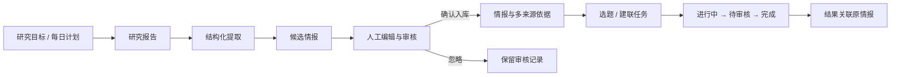

# 信息采集工作流

本轮交付的是研究到任务的共用流程。热点趋势、竞品快照和短剧榜单等专项采集仍需要各自的来源与领域实现，不能以本流程已贯通代替专项模块验收。

## 阶段与用户操作

新研究完成后自动创建整理阶段；老报告需要在研究详情点击“整理情报”。候选情报在独立页面审核，可以编辑摘要、产品、市场、类型、事实/估算/判断、发布时间、语言、标签、建议行动和来源依据。未知发布时间、语言用 null 保存，不补造数据。

“确认入库”是一次明确的人工确认，创建已确认情报；模型输出仅能创建待审核候选。若同产品已有相同主来源 URL，则关联已有情报并补充未保存的来源，保留原有标题、摘要及审核状态。若原情报为待确认或不相关，需要在情报详情另行确认，才能创建任务。

已确认情报可创建选题或建联任务，填写负责人、渠道、优先级及截止时间。任务名称默认来自情报，允许修改；首期不额外调用模型撰写脚本或建联消息。任务的产品和市场从情报继承，证据通过情报关联，结果保存在任务上并在情报详情可回查。

## 情报列表与跟进负责人

情报收件箱使用七列表头：名称 / 任务、产品 · 市场、渠道 / 类型、进展 / 表现、负责人、状态、操作。进展展示现有评分、任务总数与完成数、最近更新任务中有值的结果；渠道取关联任务真实执行渠道，状态分别展示情报审核状态和任务执行状态。未转任务、未分配、缺少评分均保留真实空态。

`GET /api/intelligence` 支持 search、status、category、product、market、range 和 owner 交集查询。search 匹配标题、摘要和跟进负责人姓名；range 为 all/7d/30d/90d，按数据库 createdAt 收集时间滚动计算（7 天 = 168 小时），有时间限制时排除未来记录。筛选保存在 URL，详情开关不丢条件；最多返回最新 100 条，尚无分页，不是来源发布时间筛选。

`GET /api/intelligence/assignees` 返回可分配成员的 ID/姓名。`PATCH /api/intelligence/:id/owner` 接收 ownerId（null 表示清空）和 revision，仅管理员/运营可操作。事务锁定情报并检查 ownerRevision，过期版本返回 409；成员必须为未停用管理员/运营。每次实际变更递增版本并记录 intelligence.owner 审计。既有情报保持未分配；停用/降权成员仍保留原姓名供追溯，但不能被新分配。

跟进负责人负责筛选与推进情报，任务 assigneeId 独立保存，变更情报负责人不会覆盖任务执行人。API 对当前列表批量读取成员和关联任务，避免逐行情报查询；列表每 10 秒刷新，详情分配后立即失效刷新。

## 模块边界

| 位置                                      | 职责                                                   |
| ----------------------------------------- | ------------------------------------------------------ |
| `packages/contracts/src/workflow.ts`      | 浏览器安全的数据契约、工作流版本、任务状态机、标签     |
| `packages/agent/src/index.ts`             | 通用研究与模型工具流                                   |
| `packages/agent/src/extract.ts`           | 无写入权限的结构化提取、报告来源整理与来源白名单验证   |
| `apps/worker/src/workflows/research.ts`   | 报告阶段执行、报告成功与下一阶段入队记录的原子提交     |
| `apps/worker/src/workflows/extraction.ts` | 按持久化版本选择提取策略、提取阶段重试与候选结果提交   |
| `apps/worker/src/main.ts`                 | Redis/队列连接、阶段派发、调度与入队补偿、进程生命周期 |
| `apps/api/src/modules/candidates`         | 候选列表、版本冲突检测、编辑、人工审核与入库事务       |
| `apps/api/src/modules/intelligence`       | 情报、证据及关联任务读取，人工录入和有效性确认         |
| `apps/api/src/modules/tasks`              | 任务创建、成员检查、状态流转、结果及审计事务           |
| `apps/web/src/features/*`                 | 领域页面，调用 API，显示服务端状态，不执行后台工作     |

这是一条代码定义的分阶段工作流，不包含通用 DAG 引擎或可视化编排器。新增产品能力应先放入对应领域模块，避免持续增加单个 Worker 函数或全能 Service 的职责。

## 持久化、幂等与恢复

- `research_runs` 保存报告阶段。报告完成与 `research_extractions` 的创建在同一事务中，后者同时是持久化待入队记录。
- `research_extractions` 每份报告唯一，保存工作流版本、状态、尝试数、错误及重试代数。Worker 定期将待执行记录补入 BullMQ。队列任务 ID 包含阶段 ID 和重试代数。
- 提取只读取已完成报告和实际来源；额外生成的 URL 必须通过报告来源白名单检查，否则整次提取失败。白名单证明来源存在于输入，不证明网页内容真实或当前仍有效，仍需人工核实。依据字段是资料摘要，不承诺已抓取的原文引述。
- 候选列表与提取成功状态在同一事务提交，以提取 ID + 位置唯一约束防止重复候选。没有可信候选是合法的成功结果。
- 提取失败最多自动尝试两次；手工“重试整理”仅重试提取阶段，递增代数，不再次执行报告研究。旧代数的晚到结果不能覆盖新代数。
- 研究内部工具调用和单次结构化模型调用目前仍是阶段内的整体重试。阶段级检查点不代表每一个模型 token 或工具步骤都能续跑；重试可能再次计费。
- 候选审核锁定候选行，使用 revision 防止旧编辑覆盖新内容。相同确认操作重复提交返回原结果；反向修改已审核结果被拒绝。
- 情报主 URL 仍按产品规范化去重；多来源依据另表保存。首期没有跨 URL 的语义去重，也没有人工合并两条既有情报的页面。
- 每条情报每种任务类型最多一个任务，唯一约束使重复点击、并发请求幂等；需要同类型的多批任务时，应增加独立的业务批次/幂等键及迁移，不移除保护后直接依赖前端防抖。
- 任务变更锁定任务行并验证 revision。进行中任务须进入待审核，才能完成；完成/失败必须填写结果/原因。任务状态机由共享契约定义，API 强制执行。负责人必须是未停用的管理员或运营。
- 写操作和重要阶段结果有审计。初期所有管理员/运营均可审核和变更任务，尚未提供“执行者不得审核自己”等独立审批策略。

## 如何扩展与修改

1. 新增采集来源：在独立来源适配器获取证据，保留运行关联；产出符合候选契约的数据后复用人工审核、情报和任务模块。竞品前后快照、短剧热度时序等仍需领域专属表。
2. 修改提取逻辑：更新提取策略及其测试。若改变字段含义、输出结构或阶段行为，发布新工作流版本并注册 handler；保留旧 handler，使已持久化的旧阶段仍按原版本恢复。手工重试保持阶段原版本。
3. 新增候选字段：契约 → 数据迁移/版本兼容 → 提取策略 → 服务与表单 → 验收测试，按顺序调整。不要直接假设历史 JSON 一定含新增必填字段。
4. 新增任务阶段：修改 `taskTransitions`，明确进入条件、角色和终态，并补非法流转的服务端测试。UI 的可选状态使用同一契约。
5. 新增耗时步骤：提供独立的持久化阶段、明确的输入输出与幂等键，由 Worker 执行；不得将模型调用塞进审核 HTTP 请求或网页组件。

## 验证与限制

`pnpm test:intelligence` 使用临时账号和记录验收产品/市场/时间交集、未来时间排除、负责人查询、只读越权、不可用成员、并发分配冲突、清空分配、任务执行人与情报负责人独立、任务汇总和审计；无需调用模型，结束清理数据。

`pnpm test` 检查契约、状态流转、来源白名单、流式研究等边界。启动本地 API、Worker、数据库和 Redis 后，`pnpm test:workflow` 使用唯一临时数据验证权限、编辑版本冲突、并发审核、来源保存、任务幂等、负责人和状态约束、结果回查、提取失败两次且报告不被重跑；默认不调用模型。

`WORKFLOW_REAL_MODEL=1 pnpm test:workflow` 会额外调用模型验证结构化提取，产生费用。有现存的纹身研究报告时只读取并复制到临时记录进行测试，不更改原研究；测试结束清理临时数据，活跃任务则保留供诊断。

本轮尚未交付：热点专属采集器和热度历史、竞品快照差异、短剧榜单/叙事结构库、收藏、CSV、语义合并、完整筛选/分页、跨组织隔离、通知、强制取消、模型费用预算与可视化工作流编辑。

## 时间信息（v2）

新提取阶段使用 `research-to-intelligence/v2`，v1 handler 保留以恢复已有阶段。候选新增可选的 `eventStartsAt`、`eventEndsAt`、`sourceTimes`；既有 JSON 记录无需补默认值，数据库物理表结构不变。

- `publishedAt`、活动起止时间支持 `YYYY-MM-DD` 或明确时区的 ISO 时间。只有日期时不补午夜、不转换日期所在时区；UI 仅在精确时间存在时显示小时与时区。
- v2 从报告提取活动时间，随后独立读取候选来源 HTML 的 JSON-LD / article meta。每次最多读取 10 个唯一来源、并发 3，每页最多 1.5 MB，单页超时 12 秒，重定向最多 3 次。元数据读取不额外调用模型。
- `sourceTimes` 保留来源 URL、核查时间、抓取状态、页面发布/更新时间及明确的 Event 起止时间。多个 Event 的日历页面不任选一个事件日期。HTTP Last-Modified、版权年份不作为文章发布时间。
- 候选主来源的发布时间有元数据时优先采用，不能借用其他来源的发布或更新时间。缺少元数据时保留报告中明确的发布日期；没有则维持 null。没有活动时间时，页面显示“未取得来源发布日期”；已有活动时间时突出活动日期，缺失说明放在来源详情，不推断网站一定没有该字段。
- 来源更新时间不表示活动发生时间，也不证明内容变化；采集时间不表示新鲜度。候选的收集时间是入库时间，每个来源的实际核查时间另行展示。
- 抓取失败保留 `unavailable` 和核查时间，不使已完成报告或候选提取失败。初期最多核查 10 个来源，未核查来源不生成虚假核查记录。只读取 HTML 元数据，不执行页面 JavaScript、不尝试绕过来源访问限制。
- 抓取仅允许 HTTP(S) 标准端口；每次重定向重新检查地址，拒绝本地/私有/保留地址，并将 DNS 检查结果固定到连接，避免读取内部服务。

候选编辑表单可编辑活动日期及来源发布日期；核查记录随候选保存，入库后进入情报 metadata，保持来源关联。删除或修改来源 URL 时，表单会去掉对应的旧核查记录。

## 机会评估阶段

新候选写入时同时创建 `opportunity_assessments` 待执行记录，独立 Worker 作业读取固定输入快照，使用当前配置模型建议逐维档位。研究、提取和评分分别有终态，评分失败不影响已完成报告或候选；候选审核不依赖评分完成。旧候选和手工情报从页面显式触发补评，人工审核或手工录入不会隐式调用评分模型。

接口、契约和计算口径见 [评分规则](./intelligence-scoring.md) 与开发说明。评分源数据变化或过期后标记待复核，未自动续费重评。证据未核实、维度未知和窗口结束均有独立状态；AI 不会自动给 A 或确认情报。
