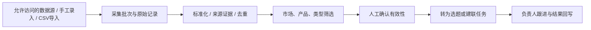

# 光魔增长：产品梳理

整理日期：2026-11-17。依据：在线能力文档 V2（2026-11-16）与 Demo 的 11 个工作台；首期范围按本次沟通调整为「基础框架 + 信息采集」。

## 1. 项目定位

光魔增长是内部增长团队的统一工作台。它连接情报、内容、渠道、客户和产品行为，让每次运营动作有依据、负责人、结果与复盘。

完整产品优先验证 MagicTattoo 的商户增长：美国英语市场、有真实作品、持续社媒宣传且仍有接单空间的独立纹身师和小型工作室。这个目标人群仍需通过访谈与人工陪跑验证。

商户的核心价值是使用真实作品制作并导出合格宣传视频。消费者免费试戴单独分析；导出不等同于真实发布，生成成功也不等同于质量认可。

## 2. 首期交付

**先把统一框架和 AI SDK 情报采集做成真实可用的系统，支持网页研究、关闭网页后继续运行和每日共享摘要。**

首期使用者：增长负责人、内容运营、商务运营和管理员。首期成功标准是团队能处理真实情报，而不是一次完成全部渠道平台接入。

框架承担登录权限、导航与路由、产品和市场上下文、真实数据持久化、任务、审计、接入状态、后台作业与错误处理。信息采集承担情报收件箱、详情、来源管理、采集记录、去重和转任务。

首期采集类型保留原文的欧美热点、竞品监控、热门短剧，并允许纹身行业商户信号。建议先用一个允许接入的真实来源验证连接器，再按相同协议扩展；不把四类自动采集同时作为上线前提。研究目标、模型与搜索供应商尚未确定；候选来源可由 Agent 发现，不要求人工预先列出全部网站。

## 3. 完整模块与分期

| 模块       | 业务作用                                    | 本次范围                                          |
| ---------- | ------------------------------------------- | ------------------------------------------------- |
| 共用框架   | 导航、权限、任务、数据与运行底座            | 首期开发                                          |
| 信息采集   | 热点、竞品、短剧与商户信号，形成下一步行动  | 首期开发                                          |
| 增长总览   | 双漏斗、渠道归因、成本与留存                | 首期只提供入口及任务/采集真实摘要，经营指标待接入 |
| 投放管理   | Google、Meta、TikTok 数据、素材、预算与实验 | 后续                                              |
| 社媒管理   | 账号、选题、视频工厂、审核和发布排期        | 后续                                              |
| SEO 管理   | 搜索需求、内容资产、页面更新与转化          | 后续                                              |
| 网红合作   | 筛选、建联、交付、授权和归因                | 后续                                              |
| 目标商户   | 工作室与联系人、线索、跟进、成交            | 后续；首期仅创建关联建联任务                      |
| 激活与留存 | 首次视频价值、复用、付费与活跃下降旅程      | 后续                                              |
| 客户分群   | 账户级动态分群与转行动                      | 后续                                              |
| 增长实验   | 假设、分流、样本、观察窗口与护栏            | 后续                                              |
| AI 自动化  | 有界生成、审批、运行记录、失败重试          | 首期实现情报 Agent 与后台运行；通用编排后续       |

## 4. Demo 已展示的内容与落地差距

Demo 有 11 个工作台、产品/市场筛选、任务列表与详情入口。信息采集包含热点、竞品和短剧示例，可触发演示采集；新增工作台展示分群转行动、实验、旅程与自动化模拟。

这些是交互与业务结构参考。真实项目仍需完成服务端存储、身份权限、数据源授权、采集作业、任务状态流转、审计、监控和部署。Demo 的浏览器内更改不会自然变成服务端业务数据。

原型需要调整的地方：

- 固定样例漏斗不随筛选变化；真实系统应按查询条件计算，未接入显示未接入，数据缺失显示未知。
- 原型不同位置使用「人」「用户」「家」表示分群与留存；落地前统一为账户级口径，并明确联系人与账户的关系。
- D7 留存、次周留存和付费各有不同观察窗口，不能把它们串成同一条逐级转化漏斗。
- 「待审核 / 已完成」任务状态不能替代网红合作阶段、商户销售阶段、采集运行状态或外部执行回执。
- 信息采集详情须补齐来源、时间、原始依据、可信度、失效时间和建议行动；AI 判断与事实分开呈现。

## 5. 首期建议对象

以下是建模建议，字段/API 在 S0 冻结，尚非现有实现。

| 对象                    | 最小职责                                                      |
| ----------------------- | ------------------------------------------------------------- |
| Workspace / User / Role | 工作区边界、成员与操作权限                                    |
| Product / Market        | 产品、国家地区、语言和时区上下文                              |
| Source                  | 来源类型、入口、授权方式、接入状态、采集频率与负责人          |
| CollectionRun           | 批次、触发方式、进度、成功/失败数、错误、重试与耗时           |
| IntelligenceItem        | 类型、标题、市场、产品、正文摘要、审核状态、有效期与负责人    |
| Evidence                | 来源 URL、原始发布时间、采集时间、允许保留的原文/摘要及其版本 |
| DedupLink               | 规范 URL / 内容指纹、重复组、合并决定和来源保留               |
| Task                    | 负责人、截止时间、优先级、状态、关联情报与执行结果            |
| AuditLog                | 操作者、时间、对象、动作、前后变化与结果                      |

情报审核状态建议：待确认、有效、不相关、已过期。收藏单独作为个人标记；是否转任务通过关联关系判断，避免混入审核状态。采集运行状态建议：排队、运行中、成功、部分失败、失败、已取消。

## 6. 后续指标原则

完整产品主指标建议：每周获得有效视频成果的活跃纹身师账户数。必须同时满足确认从业身份、当周生成并导出至少一条通过质检的视频。

后续接入产品事件时再落地以下口径：

- 24 小时激活率：注册后 24 小时内首次合格视频导出的纹身师账户 / 已完整观察 24 小时的新注册纹身师账户。
- 首次价值耗时：注册至首次合格导出，报告中位数与 P90。
- D7 复用：激活后第 7 天再次合格导出 / 已完整观察至该日的激活账户；第 7 天的时区和日边界需另行冻结。
- 周留存：激活后第 2 周有有效导出的账户 / 已成熟激活周账户，独立于 D7。
- 试用转付费：注册后固定 14 天首付 / 已观察满 14 天的试用商户账户。
- 全成本 CAC、贡献毛利与回收期：纳入相应成本与退款，不能用收入直接替代毛利。

同一工作室多人注册在账户层去重；相同 IP 不自动合并。未知归因保留未知。非订阅套餐使用复购/充值口径。

## 7. 技术决策与待定事项

项目用于内部团队。前端已确定使用 React + TypeScript + Vite、React Router、TanStack Query、Tailwind CSS 与 shadcn/ui；Agent 执行确定使用 AI SDK，网页交互采用 AI Elements；当前业务以登录后工作台为主，暂无 SEO 或服务端渲染需求，采用单页应用。登录与会话管理已确定使用 Better Auth，React 客户端连接服务端认证接口；服务端负责会话验证、业务角色和工作区权限。Better Auth 的认证 account（登录提供方账号）与业务 account（商户/工作室）需区分命名与关系。

后端已确定 NestJS + PostgreSQL + Drizzle。后台采用 BullMQ + Redis + 独立 Worker，网页关闭不影响任务执行，过程、记忆与结果持久化；详见 [Agent 架构决策](./agent-architecture.md)。首期采用 Better Auth 邮箱密码登录，由管理员开通成员，不开放公众自助注册。

部署环境、工作区数量、首批真实来源和接入权限、采集频率、原始数据保留期限、AI 供应商与单次预算、首期人员与工期仍未确认。建议先采用可部署的模块化单体、关系数据库和可靠后台作业，避免首期引入微服务或通用工作流编辑器；这属于建议，不是已确定方案。
